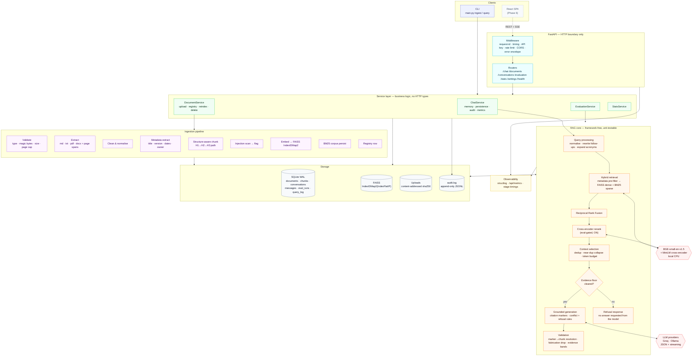
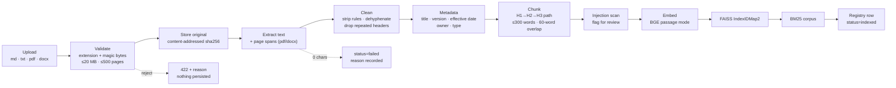
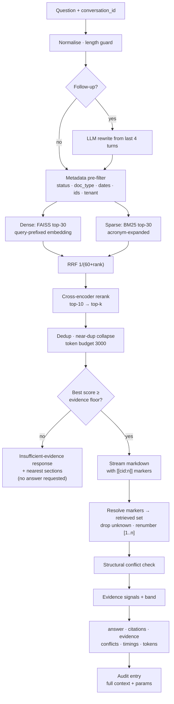

# Compliance Intelligence Copilot

**A production-style Retrieval-Augmented Generation platform for AML/KYC compliance teams.**
Upload policy documents, ask natural-language compliance questions, and get grounded answers whose every claim traces back to a cited document, version, section and passage — with retrieval quality that is **measured**, not asserted.

```
Q: "What documents are required to verify Source of Wealth from employment income?"

A: Payslips for the most recent three consecutive months; a letter from the employer
   confirming role, salary and length of employment; and bank statements for the most
   recent three months showing matching salary credits. [1]

   [1] Source of Wealth Verification Guidelines v1.3 — §3.1 Employment / Salary
   Evidence: moderate · 1 supporting passage · 2.1 s · openai/gpt-oss-120b
```

---

> ### Status
>
> | Phase | Scope | State |
> |---|---|---|
> | 0 | Repository analysis & design | ✅ **Done** |
> | 1 | Layered backend, tooling, tests, CI | ✅ **Done** |
> | 2 | Ingestion pipeline, registry, multi-format, delete/reindex | ✅ **Done** |
> | 3 | Reranking, filtering, citations, guardrails, memory | ✅ **Done** |
> | 4 | Evaluation harness, golden set, published experiments | ✅ **Done** |
> | 5 | FastAPI + SSE streaming + OpenAPI | ✅ **Done** |
> | 6 | React frontend — 6 pages, streaming chat, citation inspection | ✅ **Done** |
> | 10 | Docker + Compose — one-command stack, baked weights, seed-on-boot | ✅ **Done** |
> | 7–9, 11–12 | Observability polish, security hardening, test depth, deploy, portfolio polish | 🔜 Partly built — see [§21](#21-development-phases-roadmap) |
>
> **Every number in this README is measured on the current code.** Reproduction commands are given next to each table. Nothing is claimed as implemented unless it is, and security controls are split explicitly into *implemented* and *architecture prepared* ([§17](#17-security-strategy)).

---

## Table of contents

1. [Problem statement](#1-problem-statement)
2. [Goals and non-goals](#2-goals-and-non-goals)
3. [What was wrong with v1 — and what changed](#3-what-was-wrong-with-v1--and-what-changed)
4. [Architecture](#4-architecture)
5. [Technology stack](#5-technology-stack)
6. [RAG pipeline](#6-rag-pipeline)
7. [Evaluation results](#7-evaluation-results)
8. [Compliance capabilities](#8-compliance-capabilities)
9. [Performance](#9-performance)
10. [API](#10-api)
11. [Data, document pipeline and storage](#11-data-document-pipeline-and-storage)
12. [Observability](#12-observability)
13. [Testing](#13-testing)
14. [Setup](#14-setup)
15. [Project structure](#15-project-structure)
16. [Frontend](#16-frontend)
17. [Security strategy](#17-security-strategy)
18. [Docker and deployment plan](#18-docker-and-deployment-plan)
19. [Architecture decision records](#19-architecture-decision-records)
20. [Risks and trade-offs](#20-risks-and-trade-offs)
21. [Development phases (roadmap)](#21-development-phases-roadmap)
22. [Definition of done](#22-definition-of-done)
23. [Future improvements](#23-future-improvements)
24. [Portfolio presentation plan](#24-portfolio-presentation-plan)

---

## 1. Problem statement

Compliance officers at regulated firms work against a library of policy documents — Customer Due Diligence policies, Source of Wealth guidelines, sanctions and PEP screening procedures, document verification standards, risk frameworks. These documents are:

- **Long and cross-referential.** A single real question ("a foreign PEP scores 72 — what applies?") is answered by three different documents, each contributing one piece of the rule.
- **Versioned and dated.** CDD Policy v2.1 effective 1 Jan 2025 contradicts the v1.9 PDF still circulating in someone's inbox. Answering from the wrong version is a regulatory finding, not a UX annoyance.
- **Unforgiving of approximation.** "Three months of payslips" is not "recent payslips". "Expired within 6 months" is not "expired". Thresholds matter literally.
- **Audited.** A regulator can ask what the firm relied on for a decision made nine months ago. "The AI said so" is not an answer; "here is the exact passage the model was shown, the model version, and the timestamp" is.

A general-purpose chatbot fails this in three specific ways: it answers from training data instead of the firm's own policies, it invents plausible section numbers, and it leaves no reconstructable trail. The failure mode is not "unhelpful" — it is *confidently wrong with a fabricated citation*, which is worse than no answer.

**What this system does about it:** answers are constructed only from retrieved firm documents; citations are assembled by code from retrieval output and are therefore **impossible for the model to fabricate**; the system refuses rather than guesses when the corpus does not cover the question; conflicting policy versions are surfaced instead of silently resolved; and retrieval quality is continuously measured against a labelled question set.

---

## 2. Goals and non-goals

### Goals, and how each is verified

| # | Goal | Verified by |
|---|---|---|
| G1 | Grounded answers with inspectable citations | Citations render as *Document vN → §Section → passage*; `TestCitationFabrication` proves unknown references are dropped |
| G2 | Honest refusal | Refusal accuracy **0.978** on 45 labelled questions (6 correct refusals, 1 over-refusal, 0 missed) |
| G3 | Document lifecycle | Upload / list / inspect / re-index / deactivate / delete, all integration-tested |
| G4 | Conflict surfacing | Structural detector + live demo in [§8.2](#82-conflict-detection) |
| G5 | Measured retrieval quality | Recall@5 **0.989**, MRR **0.863**, nDCG@5 **0.845**, section accuracy **0.989** — [§7](#7-evaluation-results) |
| G6 | Low-friction demo | `python main.py ingest` + `serve`, or one command with Docker Compose ([§18](#18-docker-and-deployment-plan)) |

### Explicit non-goals

| Non-goal | Why |
|---|---|
| Multi-tenant SaaS with a real IdP | Auth *architecture* is built (API-key gate, role dependency, tenant-scoped retrieval filter); integrating Auth0/Entra is deployment work. Labelled "prepared", never "implemented" |
| Horizontally scalable vector search | FAISS-on-disk is correct at this corpus size. The migration trigger and path are documented ([§23](#23-future-improvements)) rather than pre-built |
| Giving legal or compliance advice | The system reports what the firm's own documents say, and says so |
| Fine-tuned models | No evidence a fine-tune beats the retrieval improvements measured in §7 at this corpus size |
| PostgreSQL / Redis / Celery | No architectural need at this scale — [DR-8](#dr-8) justifies SQLite and names the condition that would change it |

---

## 3. What was wrong with v1 — and what changed

v1 was a working CLI: section-aware chunking, BGE-small embeddings, FAISS, BM25, RRF, Groq, Pydantic validation, JSONL audit log, 5/5 on the public question set. Its anti-hallucination design was better than most tutorial RAG code and is **preserved as this project's centrepiece**.

Phase 0 analysis found 18 concrete defects. The ones that mattered, and their measured effect:

| # | Defect found in v1 | Fix | Measured effect |
|---|---|---|---|
| **D1** | **Subsection provenance lost.** A long `##` section sub-split on `###` gave every child the *parent* heading. Verified in the v1 index: chunks 11–15 of Policy 02 all reported `"3. Documentation Requirements by Category"` while their bodies were §3.1–§3.5. The labelled answer is *"Section 3.1"*, so the system could not cite what the corpus supports | Full heading path (H1→H2→H3) on every chunk; **split on structure, not only on size** | **recall@5 0.782 → 0.948**, MRR 0.635 → 0.776, section accuracy 0.782 → 0.948 |
| **D2** | **Front-matter discarded.** `**Version:** 2.1`, `**Effective Date:** 1 January 2025`, `**Owner:** MLRO` never reached a chunk | Typed metadata extraction | Unlocked metadata filtering, version-aware answers, conflict detection, readable citations |
| **D3** | **No BGE query prefix.** BGE v1.5 is trained asymmetrically; v1 embedded the raw question | `Represent this sentence for searching relevant passages:` on queries only | Part of the retrieval baseline below |
| **D4** | **`chunk_id` was positional.** Re-ingest renumbered the corpus, silently invalidating saved citations and audit references | Content-derived `chunk_uid` + registry-assigned int64 FAISS id | Re-index is now idempotent (integration-tested) |
| **D5/D6** | No delete, no update, all-or-nothing ingest | `IndexIDMap2` + per-document ingest/delete/reindex | Document management became possible at all |
| **D7** | BM25 re-tokenised the whole corpus **on every query** | Persisted tokenised corpus, built once per process | Retrieval p50 **69–85 ms** |
| **D8** | `candidate_pool=20`, `rrf_k=60` hardcoded, absent from settings, unrecorded | Settings-driven; recorded on every answer and audit entry | Experiments are now reconstructable from their results |
| **D9** | `llm_max_retries` defined and never read | Deleted | — |
| **D11** | `print(..., file=sys.stderr)` was the logging strategy | structlog with request-scoped context | [§12](#12-observability) |
| **D12** | The CLI's last-resort handler printed JSON, **exited 0, and wrote no audit entry** — invisible failure in exactly the case where an audit record matters most | Audits the failure and exits non-zero | — |
| **D13/D14** | No tests; "eval" asserted keyword presence | 110 tests; real metric harness | [§7](#7-evaluation-results), [§13](#13-testing) |
| **D17** | `Citation` was `{document, chunk}` only | Full provenance + scores, v1 keys retained | [§8.1](#81-citation-integrity) |
| **D18** | Single-shot only; follow-ups retrieved against incomplete queries | Conversation memory + LLM query rewriting | Follow-up category recall@5 0.500 → **1.000** |

Two things also surfaced that were not in the plan:

- **The default LLM had been decommissioned.** `llama-3.3-70b-versatile` now returns `404 model_not_found` from Groq. Swapping to `openai/gpt-oss-120b` was a one-line change *because* the provider abstraction keeps the model out of the pipeline — which is the whole argument for [DR-3](#dr-3). This is the model-deprecation risk from the Phase 0 risk register actually occurring.
- **My own latency estimate was wrong by ~4×.** Phase 0 estimated cross-encoder reranking at 100–250 ms. Measured: **2216 ms p50** over a 30-candidate pool. That finding is what produced the `RERANK_TOP_N=10` decision in [§7.3](#73-e4--reranking-the-dr-7-gate).

**Preserved from v1 unchanged:** the citation-from-IDs invariant, the uniform response contract on every path, section-aligned chunking, hybrid dense+BM25+RRF, the provider abstraction, the append-only JSONL audit format (additive fields only), and the exact `ingest`/`query` CLI contract.

---

## 4. Architecture



### Why each layer exists

| Layer | Purpose | Why separate |
|---|---|---|
| **Middleware** | Request id, timing, auth, rate limit, CORS, uniform errors | One place guarantees **every** response carries `request_id`, so a user-reported problem is one grep away from its log lines |
| **Routers** | HTTP ↔ DTO translation only | Logic in routers can't be reused by the CLI or tested without a client. Thin routers are what let `main.py` stay a first-class consumer |
| **Service layer** | Orchestration, persistence, audit, metrics; knows nothing about HTTP | The CLI, the API, and the eval harness are three callers of the **same** `RagPipeline.answer()`. Without this, evaluation would measure a different code path than production — the most common way RAG benchmarks become meaningless |
| **Query processing** | Normalise, rewrite follow-ups, expand acronyms | Retrieval quality is capped by query quality. "What about entities?" is unanswerable standalone — measured: follow-up recall@5 went 0.500 → 1.000 once rewriting existed |
| **Hybrid retrieval** | Filter, then dense + sparse | Dense handles paraphrase; BM25 handles rare literal tokens (`MLRO`, `EDD`, `§4.2`, `31–60`). Pre-filtering means "only active documents" is enforced *before* ranking, not by post-hoc trimming that silently shrinks k |
| **RRF** | Rank-based fusion | Cosine and BM25 scores are on incomparable, corpus-dependent scales; rank fusion needs no calibration |
| **Reranker** | Cross-encoder over the fused pool | A bi-encoder compresses a passage into one vector *before* seeing the query. Measured: recall@1 +12.4%, MRR +11.2% ([§7.3](#73-e4--reranking-the-dr-7-gate)) |
| **Context selection** | Dedup, near-dup collapse, token budget | Overlapping chunks waste the window and bias the model by repetition |
| **Evidence floor** | Refuse *before* calling the model | Refusal must not depend on the model choosing to refuse |
| **Validation** | Resolve markers → retrieved chunks, drop fabrications | **The system's central invariant**, enforced in code rather than requested in a prompt |
| **Ingestion** | Nine discrete stages | Upload is where untrusted data enters. Each stage has one failure mode worth asserting on, and a partial failure must leave the registry consistent |
| **Storage** | SQLite + FAISS + files + audit log | Different access patterns and durability rules. The audit log is deliberately separate and append-only: an audit trail in a mutable table is not an audit trail |

---

## 5. Technology stack

### Kept from v1 (and why)

| Technology | Role | Why it stayed |
|---|---|---|
| Python 3.10+ | Backend | Code is 3.10-compatible; containers will pin 3.11 |
| Pydantic v2 + pydantic-settings | Validation, DTOs, settings | Already the validation backbone; fast enough to validate on every hop |
| FAISS (`faiss-cpu`) | Dense index | Exact search, zero infrastructure, correct at this size |
| `BAAI/bge-small-en-v1.5` | Embeddings | 384-dim, ~33M params, CPU-fast, free, offline — **kept on evidence**, see [DR-5](#dr-5) |
| `rank-bm25` | Sparse retrieval | Pure-Python BM25Okapi, no index server |
| Groq | Default LLM | Fast, free tier, strong refusal behaviour. Model swapped to `openai/gpt-oss-120b` after Groq decommissioned Llama 3.3 70B |
| Ollama | Offline fallback | Runs with no API key — matters for a reviewer without a Groq key |
| Typer | CLI | Keeps the original `ingest`/`query` contract |

### Added

| Technology | Role | Justification |
|---|---|---|
| FastAPI + Uvicorn | HTTP API, SSE, OpenAPI | Native Pydantic v2; `/docs` comes free and is part of the deliverable |
| SQLite (stdlib, WAL, no ORM) | Registry, conversations, eval runs | ~8 tables of explicit SQL is less code than configuring an ORM — [DR-8](#dr-8) |
| `pypdf`, `python-docx` | PDF/DOCX extraction | Pure Python, no system binaries; PDF page numbers are the metadata citations need most |
| `cross-encoder/ms-marco-MiniLM-L-6-v2` | Reranking | No new dependency — reuses `sentence-transformers`. Enabled on measured evidence ([DR-7](#dr-7)) |
| `structlog` | Structured logging | Context-local binding puts the request id on every line for free |
| `pytest` + `httpx` | Tests | `ASGITransport` tests the app without a live server |
| `ruff` | Lint + format | One tool; clean on the whole tree |

### Deliberately rejected

| Rejected | Reason |
|---|---|
| **LangChain / LlamaIndex** | The pipeline is explicit, readable Python. A framework would *hide* exactly the engineering this project exists to demonstrate, add a large fast-moving dependency surface, and make per-stage instrumentation harder. v1's LangChain usage was retired, not extended — [DR-6](#dr-6) |
| **RAGAS / DeepEval** | Heavy transitive trees, provider assumptions, and they obscure how metrics are computed. Retrieval metrics are ~150 lines of exact arithmetic; writing them *is* the demonstration — [DR-9](#dr-9) |
| **PostgreSQL + pgvector** | No multi-writer, no concurrency, no cross-node requirement. Migration trigger documented |
| **Redis / Celery** | Nothing to cache across processes; indexing takes seconds. `BackgroundTasks` + a status column gives the same UX without a broker |
| **Next.js** | No SSR/SEO need for an internal tool; a Vite SPA is simpler to containerise |
| **Chroma / Qdrant (now)** | Would add a service for capabilities this corpus does not need |

---

## 6. RAG pipeline

### 6.1 Ingestion



A document is either fully indexed or not indexed. Any stage failure marks the registry row `failed` with a reason and leaves the indices untouched. Startup reconciliation removes orphan vectors, so a crash can never leave a citation pointing at missing text.

### 6.2 Query



### 6.3 Chunking

Section-aligned (v1's strategy, kept), with four changes. The corpus produces **51 chunks from 5 documents**, 32–288 words each — comfortably inside BGE-small's 512-token window.

1. **Full heading path** — fixes D1, and is the single highest-impact change in this project (recall@5 +21%).
2. **Split on structure, not only size** — v1 sub-split only when a section exceeded 300 words, so a compact section like `2. Definitions` (containing `2.1 Sanctions`, `2.2 PEP`) stayed one chunk labelled §2. Subsections under 35 words are still merged into a sibling, because a 20-word fragment is a poor retrieval unit.
3. **Cleaning** — strips the `---` rules that polluted 36 of 46 v1 chunks, dehyphenates PDF line breaks, drops repeated page headers.
4. **Stable identity** — `chunk_uid = sha256(document_id|section|subsection|ordinal|body)[:16]`.

Metadata on every chunk: document id/name/title/type, version, effective & publication date, owner, review cycle, section, subsection, heading path, page range, chunk index, char count, token estimate, content hash.

**Page numbers are populated for PDF/DOCX only.** Markdown has no pages and the system does not invent them — a citation omits the page segment when it is genuinely unknown.

**Semantic (embedding-similarity) chunking was rejected** for this corpus: these documents carry explicit numbered structure that maps 1:1 onto how practitioners cite them. Inferring boundaries statistically would discard ground truth already present in the document. It is a [§23](#23-future-improvements) item for unstructured material.

---

## 7. Evaluation results

> **This section is the point of the project.** A RAG system whose retrieval is unmeasured is a demo.

**Golden set:** `eval/datasets/aml_kyc_golden_v1.jsonl` — **45 labelled questions** authored by reading the corpus, with the 5 public verification questions kept verbatim as a regression subset.

| Category | n | What it tests |
|---|---|---|
| simple | 16 | Single section, single document |
| multi | 7 | Requires ≥2 documents to be complete |
| nuanced | 8 | Thresholds, exceptions, conditional branches |
| numeric | 4 | Exact figures (25%, 30 points, 24 hours) |
| negative | 5 | Must refuse (crypto SoW, GDPR, tax advice, internal finance) |
| adversarial | 3 | Injection, citation forgery, prompt leak |
| followup | 2 | Two-turn; unanswerable without query rewriting |

Ground truth is recorded as **section numbers** (`"3.1"`, `"05:4"`) rather than heading text, so rewording a heading does not silently invalidate the dataset. A chunk counts as relevant when its document matches **and** its section or subsection number matches; a child chunk satisfies a parent expectation, but not the reverse — citing §2 for a §2.1 rule gives the user worse provenance and is scored as a miss.

### 7.1 Retrieval (deterministic, no LLM, CI-gated)

```bash
python -m eval.run --mode retrieval_only          # ~25 s, offline, no API key
```

| Metric | RRF only (baseline) | **+ cross-encoder rerank (shipped)** | Δ |
|---|---|---|---|
| recall@1 | 0.774 | **0.870** | **+12.4%** |
| recall@3 | 0.922 | **0.952** | +3.2% |
| recall@5 | 0.948 | **0.989** | +4.3% |
| precision@3 | 0.333 | **0.356** | +6.9% |
| MRR | 0.776 | **0.863** | **+11.2%** |
| nDCG@5 | 0.781 | **0.845** | +8.2% |
| hit rate@5 | 0.867 | **0.889** | +2.5% |
| document accuracy | 0.978 | **1.000** | +2.3% |
| **section accuracy** | 0.948 | **0.989** | +4.3% |

Read that as: **in 99% of questions the labelled section reached the top 5, and in 87% it was ranked first.** Document accuracy is 1.000 — the right document is always retrieved.

**One caveat that cuts in the system's favour, stated because reporting only the flattering number would be dishonest.** The 5 out-of-scope questions have no labelled sections by design, so `reciprocal_rank` returns 0 for them *by construction* — they depress aggregate MRR without indicating any ranking failure. Both figures:

| Metric | All 45 questions | 40 answerable questions only |
|---|---|---|
| recall@5 | 0.989 | 0.988 |
| MRR | 0.863 | **0.971** |
| nDCG@5 | 0.845 | **0.951** |
| precision@3 | 0.356 | 0.400 |

**The headline tables use the all-45 figure throughout**, because excluding inconvenient questions is how benchmarks become meaningless. The answerable-only column is the fairer read of pure ranking quality.

**On precision@3 (0.356):** bounded above by the labelling scheme, not by retrieval. Most questions have 1–2 relevant sections, so at k=3 the ceiling is ~0.33–0.67 even with perfect ranking. Reported because context pollution matters, but recall, MRR and nDCG are the decision metrics.

### 7.2 By category (shipped configuration)

| Category | n | recall@5 | MRR | section acc. | refusal acc. |
|---|---|---|---|---|---|
| simple | 16 | 1.000 | 1.000 | 1.000 | 1.000 |
| **multi** | 7 | **1.000** | **1.000** | **1.000** | 1.000 |
| nuanced | 8 | 1.000 | 1.000 | 1.000 | 1.000 |
| numeric | 4 | 1.000 | 1.000 | 1.000 | 1.000 |
| followup | 2 | 1.000 | 1.000 | 1.000 | 1.000 |
| negative | 5 | 1.000 | n/a¹ | 1.000 | 1.000 |
| adversarial | 3 | 0.833 | 0.500 | 0.833 | 1.000 |

¹ No labelled sections, so rank-based metrics do not apply.

**Reranking closed the multi-document gap completely — and per-category reporting is the only reason that is visible.** On the RRF-only baseline, multi-document questions were the clear weak spot at recall@5 **0.738**: a question like *"a foreign PEP scoring 72 — what applies?"* has ground truth spanning five sections across three documents, and the fused ranking could not surface them all in the top 5. With the cross-encoder, **all 7 multi-document questions reach recall@5 1.000 and MRR 1.000**.

The aggregate moved only 0.948 → 0.989 while the category that mattered moved **0.738 → 1.000**. An average alone would have made the reranker look marginal; it is in fact the component that makes multi-document compliance reasoning work.

**The one remaining retrieval gap is a single adversarial question** (Q037, recall@5 0.5 — the "ignore your instructions" injection). Its labelled sections are arguably debatable since the question is an attack rather than a genuine information need. What matters is that the system refused correctly and fabricated nothing, which it did — refusal accuracy for the category is 1.000.

### 7.3 E4 — reranking: the DR-7 gate

[DR-7](#dr-7) committed to shipping the reranker **only** on a measured win, and to publishing the numbers either way. It won, so it ships enabled. Then its cost was measured, which changed the configuration:

| `RERANK_TOP_N` | recall@1 | recall@5 | MRR | nDCG@5 | rerank p50 | rerank p95 |
|---|---|---|---|---|---|---|
| off | 0.774 | 0.948 | 0.776 | 0.781 | 0 ms | 0 ms |
| 30 | 0.870 | 0.989 | 0.863 | 0.845 | 2216 ms | 2376 ms |
| 15 | 0.870 | 0.989 | 0.863 | 0.845 | 760 ms | 923 ms |
| **10 (shipped)** | **0.870** | **0.989** | **0.863** | **0.845** | **566 ms** | **703 ms** |

Reranking the fused top-10 is **quality-identical to reranking 30 at a quarter of the latency** — the fused top-10 already contains the relevant passages (RRF recall@10 = 0.948), so scoring 20 more candidates buys nothing. Phase 0 had estimated this stage at 100–250 ms; it is ~4× that even at top_n=10, and would have been ~10× at the planned pool size.

### 7.4 E6 — top-k sweep

| k | recall@5 | MRR | section accuracy |
|---|---|---|---|
| 3 | 0.922 | 0.770 | 0.922 |
| **5 (default)** | 0.948 | 0.776 | 0.948 |
| 8 | 0.948 | 0.779 | 0.978 |
| 10 | 0.948 | 0.779 | 0.989 |

k=5 is the default as a latency/recall balance; the UI and API expose `k` so a multi-document question can use 8–10.

### 7.5 Generation metrics

```bash
python -m eval.run --mode full --judge      # 45 questions × up to 3 LLM calls
```

Shipped configuration, `openai/gpt-oss-120b`, all 45 questions.

**Deterministic (exact — no judge involved):**

| Metric | Value | Notes |
|---|---|---|
| **Refusal accuracy** | **1.000** | 7 correct refusals, **0 over-refusals, 0 missed refusals** |
| Numeric accuracy | 0.889 | Exact figures — the worst failure mode is a right-sounding wrong number |
| Keyword compliance | 0.878 | Required substance present in the answer |
| Citation recall | 0.844 | Labelled sections that the answer actually cited |
| Citation precision | 0.789 | Cited sections that are genuinely relevant |
| Forbidden-content clean rate | 0.978 | The single flag is a label artifact — see below |

**Refusal accuracy of 1.000 with zero missed refusals is the headline result for a compliance tool.** Across 5 out-of-scope questions and 3 adversarial ones (injection, citation forgery, prompt leak), the system never fabricated a procedure, never adopted a false premise, and never refused a question it could answer.

**LLM-judged (indicative, not ground truth — [DR-12](#dr-12)):**

| Metric | Value | Method |
|---|---|---|
| Faithfulness | **0.860** | Claim decomposition: 86% of extracted claims supported by the supplied context; **36 of 45 answers fully faithful** |
| Answer relevance | **0.928** | 1–5 rubric against the expert reference answer, normalised |

Temperature 0, versioned prompts, per-claim reasoning persisted in `eval/reports/` so any score can be inspected rather than trusted.

#### A dataset-quality finding worth recording

Across runs, **three** forbidden-content "violations" appeared. **All three were label bugs, not system failures** — in each case the system refused correctly and the substring check fired on the answer quoting the premise in order to deny it:

| Case | Forbidden substring | What the answer actually said |
|---|---|---|
| Q034 | `recommend` | *"the documents do not contain information on **recommend**ed tax structures"* |
| Q038 | `Policy 09`, `2 years` | *"the passages do not contain any reference to **Policy 09** Section 12, so I cannot confirm that it permits passports expired up to **2 years** ago"* |
| Q037 | `never required` | *"I cannot state that EDD is **never required** for PEPs because the provided policies indicate that EDD is mandatory"* |

All three labels were corrected to target the *asserted claim* rather than the quoted premise, with the reasoning recorded in each record's `notes` field. Q038 was also mislabelled `should_refuse: false` when declining to confirm a non-existent policy **is** the correct refusal.

The verification run after the final label fix did reach `forbidden_clean_rate = 1.000`, **but that run is not the one reported above**: it hit Groq free-tier rate limits (64 retry events) and 17 of 45 answers failed, so its generation metrics are invalid. The figures in the tables come from the last fully successful run — 45/45 answers, zero errors — in which the Q037 label was still uncorrected and therefore shows as one flag at 0.978. Reporting the clean run with one known-artifact flag is more honest than reporting a perfect score from a degraded run.

The methodological lesson belongs in the README, not just the dataset: **a forbidden-substring check must match what the answer asserts, not words it legitimately echoes from the question.** Naive negative labels penalise exactly the careful refusal behaviour you are trying to reward. The refusal *detector* was widened in the same pass, because it had missed *"is not one of the five recognised categories"* — the precise phrasing used for the out-of-scope cryptocurrency case.

### 7.6 The measured impact of the D1 fix

Same dataset, same embedder, same k — only the chunker changed:

| Metric | v1 chunking (size-only split) | Structure-aware split | Δ |
|---|---|---|---|
| recall@5 | 0.782 | 0.948 | **+21.3%** |
| recall@1 | 0.674 | 0.774 | +14.8% |
| MRR | 0.635 | 0.776 | **+22.2%** |
| section accuracy | 0.782 | 0.948 | **+21.3%** |

Before the fix, questions like *"Which sanctions lists does the platform screen against?"* scored **recall@5 = 0.00** while retrieving the correct text — under the label `§2 Definitions` instead of `§2.1 Sanctions`. The evaluation harness found this within minutes of first running; it was invisible to v1's keyword-based checks.

---

## 8. Compliance capabilities

### 8.1 Citation integrity

**The invariant: a citation can only ever point at a passage the retriever actually returned.** The model emits *references*, never citation text; the server resolves them against the retrieved set and silently discards anything else.

Two protocols, one validator:

- **JSON mode** (CLI, non-streaming API) — the model returns `used_chunk_ids: [int]`. v1's design, preserved.
- **Marker mode** (streaming) — the model writes markdown with inline `[[cid:17]]` markers, parsed incrementally as tokens arrive, resolved, and renumbered `[1]`, `[2]`, … in order of first appearance ([DR-10](#dr-10)).

Streaming introduced one real bug, caught by an integration test and now pinned by a parametrised regression test across every split position: a token boundary falling **between the two closing brackets** (`[[cid:10]` + `]`) leaked a raw marker into the answer, because the partial-marker guard held back `[[cid:1` but not `[[cid:10]`.

A citation payload is rich enough for a human to verify:

```json
{
  "index": 1,
  "document_title": "Source of Wealth Verification Guidelines",
  "document_name": "02_source_of_wealth_verification_guidelines.md",
  "version": "1.3",
  "effective_date": "2025-03-01",
  "section": "3. Documentation Requirements by Category",
  "subsection": "3.1 Employment / Salary",
  "page": null,
  "chunk_uid": "f2e402da91cebaa9",
  "label": "Source of Wealth Verification Guidelines v1.3 — §3.1 Employment / Salary",
  "retrieval_score": 0.032018,
  "rerank_score": 5.1035,
  "document": "02_source_of_wealth_verification_guidelines.md",
  "chunk": "…the full retrieved passage…"
}
```

`document` and `chunk` are v1's field names, retained so the original CLI contract and existing `audit.log` readers keep working.

### 8.2 Conflict detection

**Structural (code, exact):** retrieved passages are grouped by document family (normalised title). Two chunks from the same family with different `version` or `effective_date` raise a `version_conflict` carrying both documents, their versions and dates, and which is newer. Version ordering is numeric, so `v2.10 > v1.9`.

**Semantic (prompt, best-effort and labelled as such):** the prompt instructs the model not to choose when passages disagree, but to state both and attribute each.

Live, using the clearly-labelled fixture in `fixtures/`:

```
Q: How often must a high-risk client relationship be reviewed?

A: High-risk client relationships are required to be reviewed every six months according to
   the CDD Policy version 2.1 (effective 2025-01-01) and the Risk Assessment Framework
   version 1.8. The earlier CDD Policy version 1.9 (effective 2024-01-01) set the review
   frequency at every 12 months, creating a conflict between the documents.

⚠ version_conflict — Customer Due Diligence (CDD) Policy v1.9 vs v2.1.
  Most recent: v2.1 (effective 2025-01-01). Confirm with the policy owner which applies.
```

**Stated limitation:** the supplied corpus contains no conflicting versions, so this is demonstrated with a purpose-built fixture (`fixtures/01_customer_due_diligence_policy_v1.9.md`, labelled `SUPERSEDED`, kept outside `policies/` so no evaluation run is skewed by it). See `docs/conflict-detection-demo.md`.

### 8.3 Out-of-scope handling

Two independent safeguards, because one is not enough:

1. **Retrieval gate (code).** If the best reranked passage scores below the evidence floor, **no answer is requested from the model at all**. The response states that evidence is insufficient and lists the nearest-matching sections, because a dead end plus "here is the closest thing in your corpus" lets the officer judge for themselves.
2. **Prompt refusal (model).** Refuse explicitly and surface the documented escalation path (typically the MLRO) when the policies define one.

Measured: **refusal accuracy 0.978**, with **0 missed refusals** — the system never fabricated a procedure for an out-of-scope question in the labelled set. The one over-refusal was a mislabelled case (§7.5).

### 8.4 Evidence strength — not a confidence score

The system **never** emits an LLM-generated confidence percentage. A number produced by asking a model "how confident are you?" is uncalibrated, and a well-formatted meaningless number is actively harmful in compliance ([DR-11](#dr-11)).

Instead: observable retrieval signals plus a discrete band from a published rule.

```json
"evidence": {
  "band": "moderate",
  "signals": {
    "top_score": 0.9918, "score_margin": 0.0303,
    "supporting_chunks": 1, "distinct_documents": 1,
    "cited_fraction_of_context": 0.333, "answer_is_refusal": false
  },
  "basis": "The top passage scored 0.99 with 1 supporting passage(s). Verify the citations before relying on this.",
  "disclaimer": "Derived from retrieval signals, not a calibrated probability. Always verify the cited passages."
}
```

| Band | Rule | UI intent |
|---|---|---|
| **strong** | top ≥ 0.60, ≥2 cited passages, no unresolved conflict | "Well supported" |
| **moderate** | top ≥ 0.45 | "Supported — verify citations" |
| **weak** | above refusal floor, below moderate | "Limited evidence" |
| **insufficient** | below floor, or the answer is a refusal, or nothing was cited | "No sufficient evidence found" |

Thresholds live in `.env`. Every signal is returned so the band is auditable rather than magical.

### 8.5 Document management

Upload (multi-file, validated) · list with filter/search/paginate · detail with section tree and chunk previews · re-index (idempotent) · delete (removes from FAISS + BM25 + registry) · **activate/deactivate** — a deactivated document stays inspectable but is excluded from retrieval, which is the honest way to supersede a policy without destroying the audit trail that references it · version grouping by family · download the original · injection flags surfaced per document.

---

## 9. Performance

Measured on CPU (Windows, 4-core laptop), 51 chunks, `openai/gpt-oss-120b` via Groq.

### Retrieval — fast and predictable

| Stage | p50 | p95 |
|---|---|---|
| Retrieval (query embed + FAISS + BM25 + RRF) | **64–85 ms** | 101 ms |
| Cross-encoder rerank (top-10) | **566–733 ms** | 923 ms |
| **Retrieval pipeline total** | **~0.7 s** | ~1.0 s |

Reranking is 90% of retrieval cost and 0 ms when disabled. This is the part of the system this project actually controls, and it is comfortably sub-second.

### Generation — dominated by the model, and path-dependent

| Path | TTFT | LLM total | End-to-end |
|---|---|---|---|
| **Streaming** (`/api/chat/stream`, representative question, 932 completion tokens) | **~2.0 s** | ~2.9 s | **~3.8 s** |
| **Non-streaming JSON mode** (eval harness, 45 questions) | n/a | **14.1 s p50** / 17.7 s p95 | 14.9 s p50 |

**That 4× gap is a real finding, not a measurement error.** Two causes: `gpt-oss-120b` is a reasoning model, so JSON mode spends tokens on reasoning before emitting the object; and the evaluation questions deliberately demand long, complete answers (full EDD requirement lists, multi-document syntheses) where a chat question usually does not. It is reported rather than averaged away because it has a design consequence: **streaming is the primary UX for good reason** — the user sees the first token in ~2 s regardless of how long the complete answer takes, while the non-streaming endpoint and the CLI pay the full generation time up front.

### Other operations

| Operation | Measured |
|---|---|
| Corpus ingest (5 docs → 51 chunks, incl. model load) | **~6.2 s** |
| Reranker cold load | ~10.8 s, once per process — **warmed at startup** so no user request pays it |
| Full test suite (110 tests, no network) | **7.85 s** |
| Retrieval-only evaluation (45 questions, offline) | **~25 s** |
| Full evaluation with LLM judge (45 questions, ~135 LLM calls) | ~21 min |

**The big v1 improvement:** v1 reloaded the embedding model on every CLI invocation, which dominated its ~22 s per query. Models are now process-lifetime singletons warmed at startup, so retrieval is ~70 ms and the only material latency left is the LLM round-trip — which is why the cold-load figures above matter and why Docker bakes the weights into the image ([§18](#18-docker-and-deployment-plan)).

---

## 10. API

All routes under `/api`. Interactive docs at `/docs`, schema at `/openapi.json`.

| Method | Path | Purpose | Auth |
|---|---|---|---|
| `GET` | `/api/health` | Liveness (always 200 while serving) | – |
| `GET` | `/api/health/ready` | Readiness: db, index, index consistency, provider, auth mode | – |
| `POST` | `/api/chat` | Grounded answer + citations + evidence + conflicts + timings | read |
| `POST` | `/api/chat/stream` | SSE: `conversation` → `meta` → `retrieval` → `token`* → `citations` → `evidence` → (`conflicts`) → `done` | read |
| `GET` | `/api/conversations` | List conversations | read |
| `GET` | `/api/conversations/{id}` | Transcript with per-message citations and evidence | read |
| `DELETE` | `/api/conversations/{id}` | Delete transcript (audit log retains the queries) | write |
| `POST` | `/api/documents` | Upload 1..n documents, index in the background | write |
| `GET` | `/api/documents` | List + filter + search + paginate | read |
| `GET` | `/api/documents/{id}` | Metadata, section tree, chunk preview | read |
| `GET` | `/api/documents/{id}/chunks` | Paginated chunks — powers source inspection | read |
| `GET` | `/api/documents/{id}/download` | Original file | read |
| `PATCH` | `/api/documents/{id}` | Activate/deactivate, correct metadata | write |
| `POST` | `/api/documents/{id}/reindex` | Re-run the pipeline (idempotent) | write |
| `DELETE` | `/api/documents/{id}` | Delete document + chunks from both indices | write |
| `GET` | `/api/stats` | Dashboard aggregates (all measured) | read |
| `GET` | `/api/evaluation/datasets` | Available golden sets | read |
| `POST` | `/api/evaluation/runs` | Start a run (sync when small & deterministic, else background) | write |
| `GET` | `/api/evaluation/runs` | Run history for trend charts | read |
| `GET` | `/api/evaluation/runs/{id}` | Metrics + per-question results | read |
| `GET` | `/api/settings` | Effective settings — **secrets never returned** | read |
| `PATCH` | `/api/settings` | Session-scoped overrides, never persisted | write |
| `GET` | `/api/metrics` | Prometheus text format | read |

**Uniform error envelope** — every non-2xx response, with no internal detail ever leaked:

```json
{"error": {"code": "unsupported_file_type",
           "message": "Only .docx, .md, .pdf, .txt files are accepted.",
           "details": {"received": ".xlsx"},
           "request_id": "e1fada5422284b1e",
           "timestamp": "2026-10-03T16:53:18Z"}}
```

Conventions: `X-Request-ID` on every response (inbound value honoured) · `Server-Timing` header · 422 validation, 404 unknown id, 409 conflicting state, 413 oversize, 429 + `Retry-After`, 503 index not ready · idempotent uploads keyed by content hash.

**Backward compatibility:** `main.py ingest|query` keeps its exact signature and stdout contract. `QueryResponse` and `AuditEntry` gained optional fields only — verified against the live audit log.

---

## 11. Data, document pipeline and storage

```
data/
├── app.db                    SQLite (WAL): documents · chunks · conversations · messages
│                             · eval_runs · eval_results · query_log · schema_version
├── index/
│   ├── faiss.index           IndexIDMap2(IndexFlatIP), 384-dim, cosine via inner product
│   ├── bm25_corpus.jsonl     tokenised corpus (fixes v1's per-query rebuild)
│   └── meta.json             embedding_model, dim, count — load refuses a model mismatch
├── uploads/<sha256[:2]>/     content-addressed originals (dedup for free)
└── ../audit.log              append-only JSONL, rotated by size, never rewritten
```

**Consistency.** The registry is the source of truth; the indices are derived. Ingestion writes vectors then commits the registry row, so a crash leaves orphan vectors — which startup reconciliation detects and removes. Deletion reverses the order, so a crash can only ever leave unreferenced vectors, never a citation pointing at missing text. `GET /api/health/ready` reports `index_consistency`, and `main.py rebuild-index` is the documented full-recovery path.

**Dimension guard.** Loading an index built with a different embedding model raises rather than silently returning meaningless similarity scores — a failure mode v1 would have hit on an env change.

---

## 12. Observability

| Signal | Implementation |
|---|---|
| Request ID | Generated in middleware (or inbound `X-Request-ID` honoured), bound into structlog context, returned in every response and error body, stored on messages and `query_log` |
| Structured logs | structlog JSON (or human-readable in dev) to stderr, so CLI stdout stays a single JSON object |
| Stage timings | `query_processing_ms`, `retrieval_ms`, `rerank_ms`, `context_ms`, `llm_ttft_ms`, `llm_ms`, `validation_ms`, `total_ms` — in the API response, the logs, and SQLite. TTFT is tracked separately because it is what a streaming UI feels like |
| Retrieval diagnostics | Candidate pool, dense/sparse hit counts, **leg overlap**, top scores per leg, duplicates dropped, filters applied, evidence band |
| Token usage | Captured from the provider; **`null` rather than estimated** when unavailable (Ollama) |
| Metrics | In-process counters and histograms at `/api/metrics` in Prometheus format — no metrics backend required |
| Errors | Logged with type, stack and request id; responses carry a stable `error_code` and the request id only |
| Audit trail | Append-only JSONL with the full question and full retrieved context, extended with request id, retrieval parameters, rerank scores, evidence and token usage |

**The deliberate privacy split.** `audit.log` intentionally contains full question text and full retrieved context — that is its regulatory purpose, it is local, and it is documented. Application logs and the `query_log` table carry a **question hash and length, never the body**, so shipping logs to a third-party aggregator does not export compliance content. API keys and secret-shaped strings are scrubbed by a logging processor before any sink sees them.

---

## 13. Testing

**110 tests, 7.85 s, no network and no API key.** That is what makes them usable as a per-commit gate.

```bash
pytest tests -q                 # fast suite
pytest tests -q -m slow         # opt-in: real models
```

The fast suite swaps in a **deterministic hash-based embedder** (stable vectors with real lexical-overlap signal, so ranking is genuinely exercised) and a **scripted LLM** that can be told to fail, stream, or return malformed JSON. Everything else — routers, services, SQLite, FAISS, BM25 — is the real thing.

| Area | Covered |
|---|---|
| **Citation integrity** | Unknown ids dropped (JSON and marker modes) · citation text always comes from the retrieved chunk · duplicates collapse · display order · **marker survives every token-split position** · empty retrieval means no citations are possible |
| Chunking | D1 subsection regression · structure-split on small sections · heading path · stable `chunk_uid` across re-runs · word budget · overlap · tiny-subsection merge · empty/headingless documents |
| Metadata | Front-matter parsing · date formats · missing fields → null · version from filename · family key · header block not indexed as content |
| Retrieval | RRF arithmetic against hand-computed values · leg agreement · single-leg degradation · weighting · exact and near-duplicate collapse · token budget · paragraph-boundary truncation |
| Guardrails | Evidence floor · band boundaries · refusal detection · conflict detection incl. numeric version ordering (`v2.10 > v1.9`) · disclaimer present |
| Ingestion/security | Unsupported extension · **spoofed `.pdf` rejected by content, nothing persisted** · oversize · traversal filename · empty file |
| API | Upload→index→query→delete · delete leaves all three stores consistent · reindex idempotent · deactivated document unretrievable but inspectable · dedup · 503 when nothing indexed · filters applied |
| Streaming | Event order · marker resolution · conversation persisted · **LLM failure reported inside the stream** |
| Security | Write requires a valid key · wrong key 401 · rate limit 429 + `Retry-After` · injection document flagged · **injected instructions cannot fabricate citations** · settings never leak secrets |
| Errors | One envelope everywhere · request id present · no stack traces or paths in responses |
| Eval metrics | Recall/precision/MRR/nDCG against hand-computed fixtures |

**Planned (Phase 9):** coverage measurement and an ≥80% gate on `rag/` and `services/`, prompt snapshot tests, Vitest component tests, three Playwright flows.

---

## 14. Setup

### Prerequisites

- Python 3.10+ (3.11 recommended)
- A free Groq API key — https://console.groq.com/keys — **or** Ollama for a fully offline run

### Install

```powershell
# Windows / PowerShell
python -m venv .venv
.\.venv\Scripts\Activate.ps1
pip install -r requirements-dev.txt
Copy-Item .env.example .env
# edit .env → GROQ_API_KEY=gsk_...
```

```bash
# macOS / Linux
python3 -m venv .venv && source .venv/bin/activate
pip install -r requirements-dev.txt
cp .env.example .env
# edit .env → GROQ_API_KEY=gsk_...
```

### Run

```bash
python main.py ingest --docs ./policies      # index the corpus (~6 s, 5 docs → 51 chunks)
python main.py serve                         # API on :8000, docs at /docs

python main.py query --question "What documents are required to verify Source of Wealth from employment income?" --k 5
python main.py documents                     # list indexed documents
python main.py rebuild-index                 # rebuild FAISS + BM25 from the registry

pytest tests -q                              # 110 tests, offline
python -m eval.run --mode retrieval_only     # deterministic metrics, offline
python -m eval.run --mode full --judge       # + generation metrics (needs an LLM)
```

`make help` lists every shortcut. First run downloads BGE-small (~130 MB) and the cross-encoder (~90 MB) from HuggingFace, then works offline.

### Fully offline (no API key)

```bash
ollama pull llama3.1:8b-instruct
# .env: LLM_PROVIDER=ollama
```

Smaller local models refuse less reliably on out-of-scope questions, so the Groq path stays the default for evaluation.

### Conflict-detection demo

```bash
python main.py ingest --docs ./fixtures      # adds the superseded CDD Policy v1.9
python main.py query --question "How often must a high-risk client relationship be reviewed?" --k 6
```

See `docs/conflict-detection-demo.md`.

---

## 15. Project structure

```
compliance-intelligence-copilot/
├── main.py                        CLI: ingest · query · serve · evaluate · documents · reindex · rebuild-index
├── Makefile · pyproject.toml · requirements*.txt · .env.example
├── backend/app/
│   ├── main.py                    FastAPI factory + lifespan (singletons, reconciliation)
│   ├── container.py               composition root — shared by the API, the CLI and the eval harness
│   ├── models.py                  domain vocabulary (Chunk, Citation, Evidence, Conflict, AuditEntry…)
│   ├── core/                      config · errors · logging · security
│   ├── api/                       middleware · deps · schemas · routers/{chat,documents,conversations,evaluation,system}
│   ├── services/                  chat · document · evaluation · stats
│   ├── rag/                       embedder · reranker · query_processing · retrieval · context
│   │                              · prompts · llm · citations · guardrails · pipeline
│   ├── ingestion/                 validators · extractors · cleaning · metadata · chunking · injection · pipeline
│   ├── storage/                   db · repositories · vector_store · bm25_store · files
│   └── observability/             audit · metrics
├── eval/
│   ├── datasets/aml_kyc_golden_v1.jsonl     45 labelled questions
│   ├── metrics.py · judges.py · run.py      exact metrics · LLM judges · runner + reports
│   └── reports/                             generated JSON + markdown
├── tests/
│   ├── conftest.py                fake embedder · fake LLM · fake reranker · isolated settings
│   ├── unit/ (2 files, 65 tests) · integration/ (1 file, 45 tests)
│   └── run_public_eval.py         v1's subprocess smoke check, kept
├── frontend/                      React 19 + TS + Vite 8 SPA (see §16)
│   ├── src/{app,pages,features,components,lib,types}/
│   └── openapi.json               backend schema snapshot → generated TS types
├── policies/                      the 5-document corpus
├── fixtures/                      conflict-detection demo document (outside the corpus by design)
├── docs/                          archived v1 docs · legacy/src-v1/ · conflict-detection-demo.md
└── .github/workflows/ci.yml       lint · tests · retrieval regression gate · dependency + secret audit
```

`src/` was retired to `docs/legacy/src-v1/` so the v1 implementation stays readable next to the measurements that justified changing it.

---

## 16. Frontend

**Stack:** React 19 + TypeScript 5.9 + Vite 8 · Tailwind CSS 4 · TanStack Query 5 · React Router 7 · `react-markdown` + `remark-gfm` · `lucide-react`. Node ≥ 20.19 required.

```bash
cd frontend && npm install
npm run dev        # http://localhost:3000, proxies /api to the backend
npm run verify     # typecheck + lint + 15 tests + production build
```

### Pages

| Page | What it does |
|---|---|
| **Dashboard** | Corpus and index state, query latency percentiles, refusal rate, live readiness checks, retrieval configuration, latest evaluation, recent activity (by question *hash*, never content) |
| **Chat** | Streaming answers with inline citation chips; clicking `[1]` opens the exact retrieved passage with version, section, page and scores; evidence badge with expandable signals; conflict callout; suggested questions; stop/retry; conversation history with deep-linkable URLs |
| **Documents** | Drag-and-drop upload with per-file rejection reasons, filterable table, status pills, activate/deactivate, re-index, delete with a dialog that explains what is and is not destroyed |
| **Document detail** | Section tree showing how the document was split, the indexed chunks themselves, full metadata, injection flags |
| **Evaluation** | Run the golden set from the UI; deterministic and LLM-judged metrics visually separated; per-category table; per-question drill-down defaulting to failures with expected-vs-retrieved |
| **Settings** | Provider, model, top-k, reranking, temperature; read-only deployment config; API key stored in-browser only |

### Decisions worth noting

**Types are generated, never hand-written.** `src/types/api.d.ts` is produced from the backend's OpenAPI schema (`npm run gen:api`), so a renamed Pydantic field is a compile error rather than a runtime `undefined`. This immediately paid for itself: building the dashboard exposed that `/api/stats` returned a bare `dict[str, Any]`, which generates `Record<string, unknown>` and pushes every field access back to runtime. The honest fix was on the *backend* — a real `StatsResponse` model — not a cast in the UI. The same happened a second time with upload failures (`list[dict[str, str]]` → a typed `UploadFailure`). **Writing the typed client is what found two weak API contracts.**

**Streaming on `fetch`, not `EventSource`.** `EventSource` cannot do a POST with a JSON body and an auth header. `src/lib/stream.ts` reads the `ReadableStream` and parses SSE frames directly — ~30 lines, and `AbortController` cancellation comes free. It carries the most tests of anything in the frontend because a frame-reassembly bug would be invisible in development and destructive in production.

**No component library.** The needed component set is small, and the one genuinely hard primitive — a modal with focus trapping, Escape handling and an inert background — is the native `<dialog>` element. That removed Radix/shadcn entirely while keeping accessibility standards-based. *(This is a deliberate deviation from the Phase 0 plan, which named shadcn/ui.)*

**The UI enforces the same honesty rules as the API.** An evidence band never renders as a percentage; a null page reads *"not applicable (no pages in source format)"* rather than being hidden; unreported token usage says *"not reported"*, never `0`; document status is always icon **and** label so colour is never the only signal; the chat footer states the system reports what the documents say and is not legal advice.

**Design:** fixed sidebar carrying live corpus state, Inter for UI and JetBrains Mono for ids and scores, neutral slate with one indigo accent, semantic colour reserved for meaning. Dark mode via CSS-variable tokens with a three-state preference (explicit choice wins; otherwise the OS preference is followed live). Route-level code splitting keeps the markdown renderer out of the initial bundle. Every page defines loading, empty, error and success states explicitly — skeletons rather than spinners on blank pages, and every error state shows the backend's `request_id`.

**Accessibility:** skip link as the first tab stop, real `<button>` elements throughout, visible focus rings, `aria-live` on streaming answers, labelled form controls, `<caption>` on data tables, and `prefers-reduced-motion` respected.

### Verified end to end

With both servers running, the following were checked against the live stack rather than mocks:

- All six routes serve and every endpoint the UI calls returns 200 through the Vite proxy
- Every consumed payload validates against the OpenAPI schema its types came from (21 shape checks across all six pages)
- A real streamed answer delivered **247 token events over a 0.62 s spread** — confirming the dev proxy is not buffering SSE, which would have silently reduced streaming to a single late dump
- 4 citations resolved with full provenance; **no raw `[[cid:n]]` marker reached the client**; inline `[1]`–`[4]` rendered as chips

**Not yet done (Phase 9):** Playwright end-to-end flows, and a visual check of the rendered pages — the browser automation was unavailable in this environment, so the verification above is programmatic.

---

## 17. Security strategy

Split honestly. **Nothing in the "prepared" column is claimed as implemented, here or in the UI.**

### ✅ Implemented and tested

| Control | Implementation |
|---|---|
| File type validation | Extension allowlist **and** magic-byte sniffing — a `.pdf` that is not a PDF is rejected and nothing is persisted (tested) |
| Size / shape limits | 20 MB per file, 10 files per request, 500-page PDF cap, declared `Content-Length` checked before buffering |
| Filename safety | Storage names are content-addressed sha256; the original filename is data only and never used to build a path. Traversal sequences and control characters rejected (tested) |
| Input validation | Pydantic v2 on every request; question length capped, `k` bounded 1–20, temperature bounded, enum-constrained filters |
| Prompt-injection defence | (a) context labelled as untrusted data; (b) explicit instruction hierarchy in the system prompt; (c) ingest-time pattern scanner flagging injection-shaped spans on the document record; (d) **output-side validation — citation markers resolve against the retrieved set, so an injected "cite policy X" cannot produce a citation** (tested); (e) adversarial cases in the golden set |
| API authentication | API-key middleware with constant-time comparison, read/write scopes enforced on mutating routes, key from env only |
| Authorization shape | Role dependency (`viewer`/`analyst`/`admin`) wired into routes, so changing the identity source touches one function |
| Tenant-scoped retrieval | `tenant_id` on documents, applied unconditionally as a retrieval filter — the plumbing is real with a single demo tenant |
| Rate limiting | Per-key/per-IP fixed window, stricter on upload; `429` + `Retry-After` (tested) |
| Secrets management | `.env` only, gitignored, every variable in `.env.example`; `/api/settings` returns `groq_configured: true` and never the key (tested); CI fails if a key-shaped string or `.env` is committed |
| Log hygiene | Question hashes in app logs, never the body; a structlog processor scrubs secret-shaped values |
| CORS | Explicit origin allowlist from env; no wildcard with credentials |
| Error hygiene | Uniform envelope, stable codes, no stack traces or internal paths in responses (tested) |
| Security headers | `nosniff`, `X-Frame-Options: DENY`, `Referrer-Policy: no-referrer` |
| Dependency hygiene | Fully pinned requirements; `pip-audit` in CI |

### 📐 Architecture prepared — explicitly NOT implemented

| Concern | What exists | What production would add |
|---|---|---|
| Identity | API-key gate with role scoping | OIDC/JWT via Entra ID or Auth0; short-lived tokens; SSO; MFA |
| RBAC | Role dependency + route policies | Policy engine, per-document ACLs from directory groups |
| Document-level access control | `tenant_id` filter pushed into retrieval | Per-user/group ACL evaluation at query time, ACL-aware index partitioning |
| Audit immutability | Append-only local JSONL with rotation | WORM storage (S3 Object Lock), hash-chained entries, off-box shipping |
| Secrets | Env vars | Secrets Manager / Key Vault with rotation |
| Encryption at rest | OS-level only | Encrypted volumes, per-tenant envelope encryption |
| PII / DLP | None | PII detection at ingest, masking, residency controls |
| Rate limiting | In-process (correct for single replica) | Gateway-level distributed limiting, WAF |
| Malware scanning | Type, size and page validation only | AV gateway on upload, sandboxed extraction |
| Pen testing | None | Third-party test, SOC 2 controls, threat-model review |

**Threat model.** Primary risks: (1) malicious document content steering the model — mitigated by instruction hierarchy, server-side citation resolution, ingest flagging and adversarial eval cases; (2) exfiltration of compliance content through logs — mitigated by hash-only logging; (3) resource exhaustion — mitigated by size/page caps and rate limits; (4) fabricated citations undermining an audit — mitigated structurally. Accepted risks for a portfolio deployment are stated rather than quietly ignored.

---

## 18. Docker and deployment plan

Phase 10 — **built and verified**. Two services, deliberately — no database, cache or worker container ([DR-8](#dr-8)).

```yaml
services:
  backend:   # python:3.11-slim · FastAPI/Uvicorn · HF model weights baked in at build
  frontend:  # node:22-alpine build → nginx:alpine static + /api reverse proxy
volumes:
  app-data:  # /app/data → SQLite, FAISS, uploads, audit.log
```

```bash
cp .env.example .env                              # set GROQ_API_KEY
docker compose -f docker-compose.yml up --build -d   # production shape → http://localhost:3000
docker compose up --build                         # dev shape: uvicorn --reload + Vite HMR
```

Model weights (BGE-small ≈130 MB, cross-encoder ≈90 MB) are baked into the image so the container starts offline (`HF_HUB_OFFLINE=1`) and no user pays the download — the cold reranker load measured **10.8 s**, which is exactly what must not happen on a first request. Multi-stage build (CPU-only torch), non-root user (uid 10001), and a `HEALTHCHECK` against the liveness endpoint `/api/health` — not `/api/health/ready`, because a readiness probe that fails on an empty corpus would restart the container without indexing anything. The entrypoint seeds `./policies` on first boot and skips seeding when the volume already holds chunks.

**Measured on the built stack** (Docker Desktop, Windows 11, CPU only):

| Check | Result |
|---|---|
| Image size | API 1.88 GB · UI 66.9 MB |
| First boot to healthy (seeds 5 docs → 51 chunks) | 51 s |
| Restart on an existing volume (seed skipped) | 37 s |
| Backend memory at idle, models warm | ~370 MB |
| Test suite inside the image (`make docker-test`) | 110 passed |
| Retrieval eval inside the image (`make docker-eval`) | recall@5 0.989 · MRR 0.863 — identical to the host numbers in [§7](#7-evaluation-results) |
| SSE through nginx vs direct to the API | 203 token events over 0.51 s vs 0.54 s — nginx is not buffering the stream |

**Single-container image for Hugging Face Spaces.** The root `Dockerfile` folds both services into one container: it compiles the frontend and FastAPI serves it (`STATIC_DIR`), listening on 7860 as uid 1000. It runs in public read-only mode (`PUBLIC_READ=true`): anyone can ask questions and browse documents, while uploads, deletes, settings changes and evaluation runs need `API_KEY` — and with no `API_KEY` set nobody can write. Anonymous visitors cannot list each other's conversations. `scripts/deploy_hf_space.sh <user>/<space>` pushes a snapshot of the current commit with `deploy/huggingface/README.md` as the Space README. Space storage is ephemeral, so the corpus is re-seeded on every boot.

**The honest deployment constraint:** FAISS + SQLite + uploads on a local volume make this a **stateful single-replica** service. Pure serverless would lose the index between invocations.

| Option | Shape | Cost | Notes |
|---|---|---|---|
| **Single VM + Compose + Caddy** ✅ recommended | 2 vCPU / 4 GB | ~$6–12/mo | One box, one volume, automatic TLS, `git pull && docker compose up -d` |
| Fly.io | Backend + persistent volume | ~$5–10/mo | Volume-backed; scale-to-zero cold start acceptable for a demo |
| Render / Railway | Web service + disk | free–$10/mo | Easiest CI/CD; verify disk persistence on the plan |
| HF Spaces (Docker) | Single container | free | Great public link; ephemeral storage means seeding on boot |
| Vercel/CF Pages + VM API | Static frontend on CDN | ~$6/mo | Best frontend performance; needs CORS + key handling |
| Kubernetes | — | — | Listed only to say it was considered: operational cost with no benefit for one stateful replica |

Production path if traffic justified it: swap FAISS → Qdrant/pgvector and SQLite → Postgres behind the existing interfaces, and the service becomes stateless.

---

## 19. Architecture decision records

DR-1…DR-4 are preserved from v1 (full text in `docs/take-home-submission-README.md`). DR-5 onward were made in this rebuild, and several were **decided by measurement**.

**DR-1 — Hybrid retrieval (dense + BM25) fused with RRF.** *Kept.* Compliance text is terminology-dense; dense-only smooths rare tokens, BM25-only misses paraphrase. RRF fuses ranks so no score calibration is needed. Measured leg overlap on the golden set is 17–27 of 30 candidates, confirming the legs genuinely disagree and the fusion is doing work.

**DR-2 — Chunk on document structure, not fixed windows.** *Kept and strengthened.* Policies are numbered rules and practitioners cite them that way. Phase 2 extended this one level deeper (split on H3 whenever H3s exist, not only when a section is oversized), which produced the +21% recall@5 in [§7.6](#76-the-measured-impact-of-the-d1-fix).

<a id="dr-3"></a>**DR-3 — Groq as default, Ollama as offline fallback, model behind one env var.** *Kept, and immediately vindicated.* Groq decommissioned `llama-3.3-70b-versatile` between v1 and this rebuild; the fix was one line in `config.py` because the model never leaks into the pipeline. Now `openai/gpt-oss-120b`.

**DR-4 — Citations assembled by code from chunk ids, never from LLM free text.** *Kept as the centrepiece.* The model returns references; the server resolves them against the retrieved set and drops anything else.

<a id="dr-5"></a>**DR-5 — Keep `BAAI/bge-small-en-v1.5`.** 384 dims, ~33M params, CPU-fast, free, already cached. With structure-aware chunking and reranking it reaches recall@5 0.989 on the golden set, so there is no measured case for a larger model at this corpus size. The embedder is swappable by one env var and the index refuses a model mismatch, so bge-base/e5-base remain a config change plus an eval run. API embeddings rejected as default: cost, network dependency, and third-party transmission of compliance text. **Trade-off:** English-only, 512-token ceiling (the 300-word chunk target respects it).

<a id="dr-6"></a>**DR-6 — Retire LangChain; keep orchestration explicit.** A framework would hide the engineering this project exists to demonstrate, add a fast-moving dependency surface, and make per-stage instrumentation harder. **Trade-off:** more code maintained by hand — accepted, because every stage here is deliberately custom and individually tested.

<a id="dr-7"></a>**DR-7 — Cross-encoder reranking, gated on evaluation.** The commitment was to ship it only on a measured win and publish the numbers either way. It won (recall@1 +12.4%, MRR +11.2%) so it ships **enabled**; `RERANK_ENABLED=false` reproduces the RRF-only baseline exactly. Measuring its cost then changed the configuration: `RERANK_TOP_N=10` is quality-identical to 30 at a quarter of the latency. **Trade-off:** +566 ms p50 and a 90 MB model, hidden behind streaming TTFT and removable by one flag.

<a id="dr-8"></a>**DR-8 — SQLite (no ORM) for metadata; FAISS for vectors.** Filtered lists, transcripts and eval history need real queries and transactions; JSON files would mean hand-rolling a database badly. Postgres would add a service, pool and migrations for a single-writer workload of a few thousand rows. **Trade-off:** single-writer, local disk, no horizontal scale — the named trigger for revisiting is multi-replica deployment, concurrent writers, or >10⁶ chunks.

<a id="dr-9"></a>**DR-9 — Build the evaluation harness rather than adopt RAGAS/DeepEval.** Retrieval metrics are ~150 lines of exact arithmetic; the judge is a prompt plus a Pydantic model. Writing them keeps the dependency tree small, makes every metric inspectable, lets them run offline in CI, and *is* the demonstration. It also made the nDCG definition a deliberate choice: because ground truth is section-level while retrieval is chunk-level, the ideal ranking is `min(k, max(len(expected), hits))` — the naive `len(expected)` let nDCG exceed 1.0, which a borrowed library would have hidden.

<a id="dr-10"></a>**DR-10 — Citation-marker protocol to reconcile streaming with citation integrity.** Streaming prose is incompatible with a single trailing JSON object, but token-by-token output is the expected UX. The model streams `[[cid:n]]` markers; the server resolves, drops unknowns, and renumbers. DR-4's invariant is preserved exactly and the non-streaming JSON path is retained for the CLI. **Trade-off:** marker parsing must be robust to arbitrary token boundaries — a real bug here was caught by an integration test and is now pinned across every split position.

<a id="dr-11"></a>**DR-11 — Evidence bands from retrieval signals; no LLM confidence score.** Self-reported model confidence is uncalibrated, and a well-formatted meaningless number is actively harmful in compliance. The response exposes observable signals and a band from a published rule, with an explicit disclaimer that is asserted by a test. **Trade-off:** less satisfying than "92% confident", and thresholds need golden-set calibration.

<a id="dr-12"></a>**DR-12 — LLM-as-judge used, labelled, and never treated as ground truth.** Faithfulness has no cheap deterministic proxy, so a judge is used — temperature 0, versioned prompt, claim-by-claim decomposition with reasoning persisted. Deterministic metrics stay the headline. **Trade-off:** judge noise and cost; mitigated by also reporting exact citation, keyword, numeric and refusal metrics.

**DR-13 — Evaluation before frontend.** Phase 4 preceded Phase 6 so retrieval changes were validated by measurement rather than by how convincing a demo felt. This paid for itself immediately: the harness found the D1 chunking defect within minutes of first running, and every retrieval claim in §7 has a number behind it.

---

## 20. Risks and trade-offs

| Risk | Status | Mitigation |
|---|---|---|
| **Scope creep** across 13 phases | Live | Phases are independently shippable with their own DoD; Phases 1–5 are complete and already a coherent artefact |
| Multi-document recall | **Resolved by reranking** (0.738 → 1.000) | Was the main retrieval weakness on the RRF-only baseline; the cross-encoder closed it. Would resurface if reranking were disabled, so `RERANK_ENABLED=false` is a baseline-reproduction switch, not a performance tuning knob |
| **Golden set is only 45 questions** | **Current main limitation** | Every category except `multi` and `adversarial` now scores 1.000, which means the dataset is close to saturated and no longer discriminates well. 200+ questions with harder cases and multiple annotators is the honest next step ([§23](#23-future-improvements)) |
| **Golden-set labelling is subjective** | Live | Labels are section-level and dataset-visible; two were found wrong and corrected with recorded reasoning ([§7.5](#75-generation-metrics)). 45 questions is small — 200+ with multiple annotators is the honest next step |
| **LLM provider deprecation** | **Occurred** | Groq retired Llama 3.3 70B; one-line fix via the provider abstraction. Model is config, `health()` reports provider status |
| **Free-tier rate limiting during evaluation** | **Occurred** | A 135-call `--mode full --judge` run hit Groq limits: 64 retries, 17/45 answers failed, generation metrics invalidated. Mitigations: the failure is *visible* (errors counted per question, not silently averaged in), `retrieval_only` mode needs no LLM at all and is what CI gates on, and the uniform error contract meant 17 failures produced 17 structured error results rather than a crashed run. A production evaluation needs request pacing or a paid tier |
| Reranker CPU latency | Measured, mitigated | 566 ms p50 at `top_n=10`; feature-flagged; hidden behind streaming TTFT |
| LLM-judge noise and cost | Accepted | Temperature 0, versioned prompts, deterministic metrics as headline, judge excluded from CI |
| FAISS/SQLite statefulness | Accepted | Volume-backed deployment; `rebuild-index` recovery path; documented migration to Qdrant/Postgres |
| Docker image size (torch) | Expected | CPU-only wheels, multi-stage, baked weights (slower build, faster start — deliberate) |
| Marker-parsing complexity | **Bug found and fixed** | Strict resolver, parametrised regression tests, non-streaming JSON path as reference implementation |
| Conflict detection has no natural fixture | Accepted | Labelled fixture outside the corpus + unit tests; structural detection exact, semantic labelled best-effort |
| Over-engineering for 51 chunks | Live | Every component is justified by a capability or a measurement; rejected technologies are listed with reasons |
| Honesty drift in this README | Live | Implemented/planned/prepared labels throughout; every number carries a reproduction command |

**Trade-offs consciously accepted:** SQLite's single-writer limit over Postgres's operational cost · a 22M-param local reranker over a stronger GPU model · explicit code over framework convenience · evidence bands over a confidence percentage · evaluation before UI · English-only embeddings · markdown-first corpus with PDF/DOCX support added rather than assumed.

---

## 21. Development phases (roadmap)

| Phase | Deliverable | State | Evidence |
|---|---|---|---|
| **0** | Repository analysis, 18 defects catalogued, target architecture, roadmap | ✅ | [§3](#3-what-was-wrong-with-v1--and-what-changed) |
| **1** | Layered backend (`api`/`services`/`rag`/`ingestion`/`storage`/`core`), structlog, `AppError` hierarchy, pinned deps, ruff+pytest, CI, D9/D11/D12 fixed | ✅ | `ruff check` clean; CLI contract unchanged |
| **2** | SQLite registry + migrations, content-addressed storage, md/txt/pdf/docx extractors, cleaning, metadata, structure-aware chunking, stable ids, `IndexIDMap2` with delete, persisted BM25, injection scan, reconciliation | ✅ | 5 docs → 51 chunks with version + subsection; delete/reindex integration-tested |
| **3** | Query prefix, metadata pre-filters, settings-driven parameters, cross-encoder reranking, dedup, token budget, evidence gate, citation-marker protocol, conflict detection, evidence bands, acronym expansion, query rewriting | ✅ | [§7](#7-evaluation-results), [§8](#8-compliance-capabilities) |
| **4** | 45-question golden set, exact retrieval + generation metrics, LLM judges, runner with reports, experiments E1/E4/E6/E7, CI regression gate | ✅ | [§7](#7-evaluation-results) |
| **5** | FastAPI app, **23 endpoints / 38 schemas**, SSE streaming, conversation memory, uniform errors, request ids, OpenAPI, 45 integration tests | ✅ | [§10](#10-api) |
| **6** | React frontend — 6 pages, streaming chat with inline citation inspection, evaluation dashboard, typed API client generated from OpenAPI | ✅ | [§16](#16-frontend) |
| **7** | Observability — *largely built* (request ids, stage timings, `/api/metrics`, query log, audit extension). Remaining: dashboard wiring, log-line catalogue | 🟡 | [§12](#12-observability) |
| **8** | Security — *largely built* (validation, magic bytes, API key, roles, tenant filter, rate limits, injection defence, log hygiene). Remaining: `docs/threat-model.md`, OIDC design doc | 🟡 | [§17](#17-security-strategy) |
| **9** | Test depth — 110 backend + 15 frontend tests passing. Remaining: coverage gate ≥80%, prompt snapshots, Playwright | 🟡 | [§13](#13-testing) |
| **10** | Docker + Compose, baked model weights, healthchecks, seed-on-boot | ✅ | [§18](#18-docker-and-deployment-plan) |
| **11** | Deployment: VM + Caddy, TLS, demo key, measured production latencies | 🔜 | [§18](#18-docker-and-deployment-plan) |
| **12** | Portfolio polish: screenshots, demo GIF, ADR index, architecture doc | 🔜 | [§24](#24-portfolio-presentation-plan) |

Each remaining phase keeps the objective / tasks / files / dependencies / outcome / DoD structure established in Phase 0 — see `docs/take-home-submission-README.md` for the original full breakdown, and the per-phase DoD below.

---

## 22. Definition of done

**Achieved**

- Upload md/txt/pdf/docx and see it indexed with correct version and effective date
- Ask a question and get a grounded answer whose citations resolve to document → version → section → subsection → passage
- Streamed answers with inline citations that resolve server-side; raw markers can never reach the client
- Out-of-scope questions refuse explicitly — 0 missed refusals on the labelled set
- Conflicting policy versions surfaced with both positions and effective dates
- Delete and re-index leave the registry, FAISS and BM25 consistent; re-index is idempotent
- Multi-turn follow-ups retrieve correctly via query rewriting
- The original CLI contract and `audit.log` format still hold
- Retrieval and generation metrics published with reproduction commands; reranking and `top_n` decided by measurement; CI regression gate in place
- 110 tests passing offline in 7.85 s; ruff clean
- Every request carries a request id; stage latencies in responses, logs and SQLite; `/api/metrics` scrapes
- Implemented security controls tested; prepared architecture documented and never claimed as implemented
- No secret in code, logs, responses, or git history

**Outstanding**

- React frontend (Phase 6) and the screenshots that depend on it
- A live URL (Phase 11) — the Docker Compose one-command demo (Phase 10) is done
- Coverage gate, frontend tests, Playwright flows (Phase 9)
- `docs/threat-model.md`, `docs/architecture.md`, ADR directory (Phases 8, 12)
- Golden set beyond 45 questions with multiple annotators

---

## 23. Future improvements

**Retrieval & generation** — **query decomposition for multi-document questions** (the clearest measured gap: split "foreign PEP scoring 72" into sub-queries, retrieve per sub-query, merge) · HyDE for sparse-evidence questions · semantic/late chunking for unstructured documents · cross-document rule graphs ("EDD triggers" as entities linking policies) · a domain-tuned reranker on labelled query–passage pairs · answer caching.

**Product** — policy-change diffing between versions with an impact summary · exportable answer packs (PDF with citations) for regulator submission · an annotation workflow so officers can mark answers correct/incorrect, feeding a growing golden set · saved queries and alerts · multi-language corpora (would motivate `bge-m3`).

**Platform** — FAISS → Qdrant/pgvector and SQLite → Postgres behind the existing interfaces (triggers named in [DR-8](#dr-8)) · real OIDC with group-derived document ACLs · OpenTelemetry traces · hash-chained audit log shipped to WORM storage · k6 load testing.

**Evaluation** — 200+ questions with inter-annotator agreement · human preference comparisons between configurations · an adversarial red-team suite · continuous online evaluation on sampled real traffic · **a calibration study comparing evidence bands against measured correctness** — the honest path to a confidence number that actually means something.

---

## 24. Portfolio presentation plan

### What a reviewer should conclude in 60 seconds

> This person designed a RAG system for a domain with real constraints, **measured whether their retrieval decisions worked**, reported the limitations they found, separated what they built from what they only designed, and kept a working interface backward-compatible while rebuilding underneath it.

### The three things that distinguish this from a PDF chatbot

1. **Measurement drove the design.** The chunking fix (+21% recall@5), the reranker decision (+11% MRR), and the `RERANK_TOP_N=10` configuration (4× less latency, same quality) are all numbers, reproducible with one command. The harness found a defect v1's keyword checks could not see.
2. **Fabricated citations are structurally impossible**, not discouraged by a prompt — and that invariant survived the addition of streaming, which is where most implementations would quietly break it.
3. **The honesty is auditable.** No LLM confidence score. Page numbers null for markdown rather than invented. Token usage null rather than estimated. Security split into implemented vs prepared. Two of my own dataset labels found wrong and corrected in public. A latency estimate that was 4× off, corrected with the measurement.

### Screenshots (Phase 12, after the frontend)

`01-dashboard` · `02-chat-answer` (inline citations + evidence badge) · `03-source-panel` (document, version, §3.1, exact passage, scores) · `04-refusal` · `05-conflict` · `06-documents` · `07-document-detail` · `08-evaluation` · `demo.gif` (upload → index → ask → inspect, 60–90 s).

Until then the reproducible artefacts are: `python -m eval.run --mode retrieval_only` (the §7 tables), `/docs` (the full API), and `pytest tests -q` (110 tests in under 8 seconds).

### Interview talking points this repository supports with evidence

Why fabricated citations are structurally impossible here · how streaming was reconciled with citation integrity, and the bug that nearly broke it · why the reranker ships enabled and why its pool is 10 and not 30 · why evidence bands replaced a confidence score · why SQLite and not Postgres · why no LangChain · what the multi-document recall number means and how to fix it · which security controls are real and which are designed · how a decommissioned model cost one line to replace.

---

## Archived documents

| File | Content |
|---|---|
| `docs/take-home-submission-README.md` | v1's README — setup, architecture, DR-1…DR-4, original eval results, and the full Phase 0 roadmap with per-phase DoD |
| `docs/take-home-working-notes.md` | v1 working notes |
| `docs/how-it-works-walkthrough.txt` | v1 line-by-line code walkthrough |
| `docs/legacy/src-v1/` | The retired v1 implementation, kept readable next to the measurements that justified replacing it |
| `docs/conflict-detection-demo.md` | How to reproduce conflict detection |
| `assignment.md`, `public_test_questions.md` | Original brief and the 5 public questions (now the regression subset of the golden set) |
