<div align="center">

# 🛡️ Compliance Intelligence Copilot

**A Retrieval-Augmented Generation (RAG) platform for AML/KYC compliance teams.**

Upload policy documents, ask questions in plain English, and get answers where every claim links to the exact **document → version → section → passage** it came from.


**Recall@5 0.989 · MRR 0.863 · Section accuracy 0.989 · 0 missed refusals**
<br/><sub>measured on a 45-question labelled evaluation set</sub>

</div>

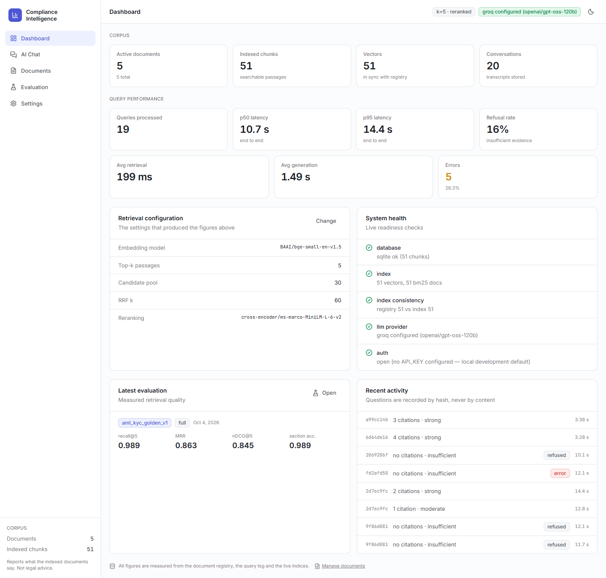

---

## Overview

Compliance officers answer questions like *"This client is a foreign PEP with a risk score of 72. What applies?"* by searching long, versioned policy documents. General-purpose chatbots are risky here: they answer from training data instead of the firm's policies, and they invent plausible-looking citations.

This project answers **only** from the firm's own documents:

- 📎 **Every claim is cited** down to the section and exact passage, and you can click a citation to open it.
- 🔒 **Citations can't be fabricated.** They're built by code from the passages the retriever actually returned, never written by the model.
- 🛑 **It refuses instead of guessing.** If retrieval finds no strong evidence, the LLM is never called.
- ⚠️ **It flags conflicting policy versions** instead of silently picking one.
- 📜 **It writes an audit record of every answer**: question, exact context, model and timestamp.
- 📊 **Its quality is measured.** A custom evaluation harness runs in CI and fails the build if retrieval quality drops.

---

## Screenshots

<table>
<tr>
<td width="50%"><b>Grounded answer with inline citations</b><br/>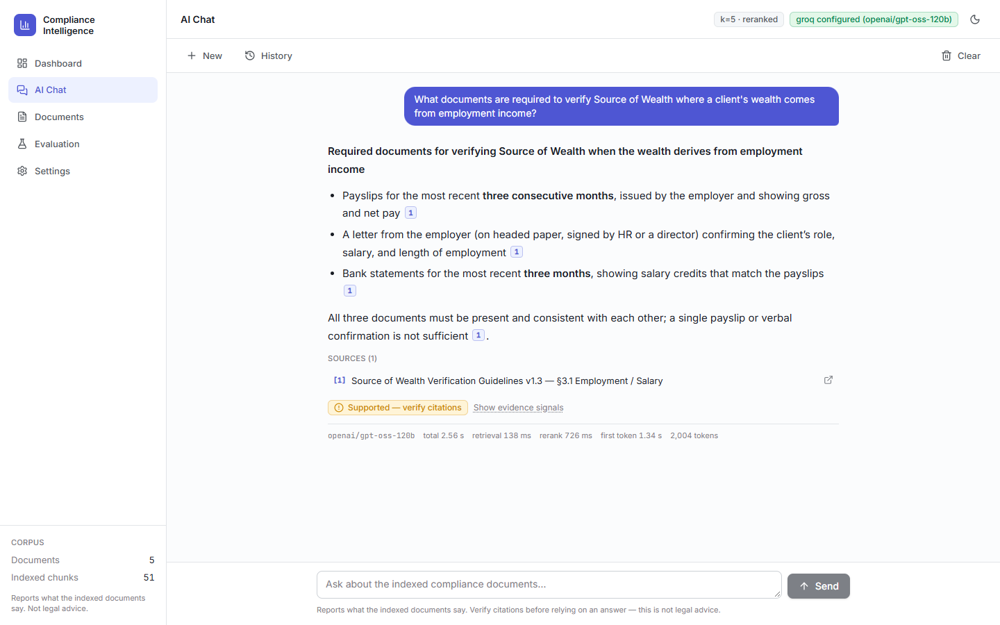</td>
<td width="50%"><b>Click a citation to see the exact source passage</b><br/>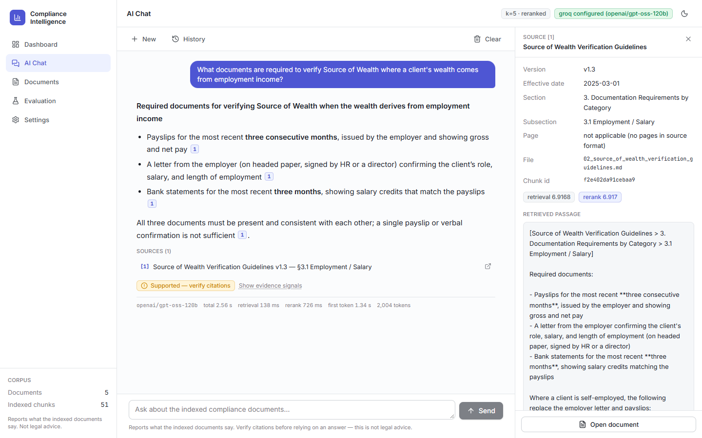</td>
</tr>
<tr>
<td><b>One answer drawing on three different policies</b><br/>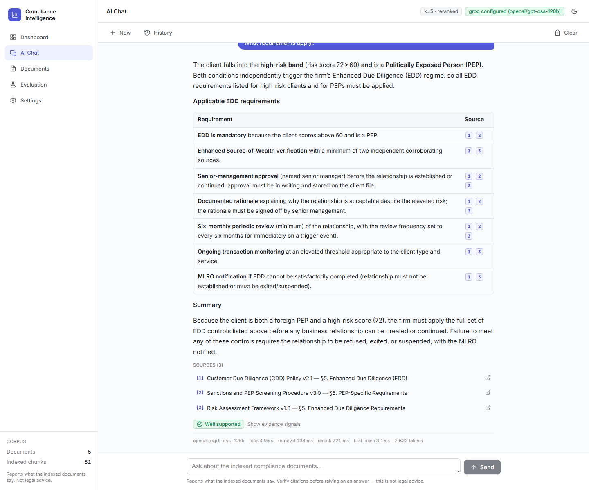</td>
<td><b>Out-of-scope question: escalates instead of inventing</b><br/>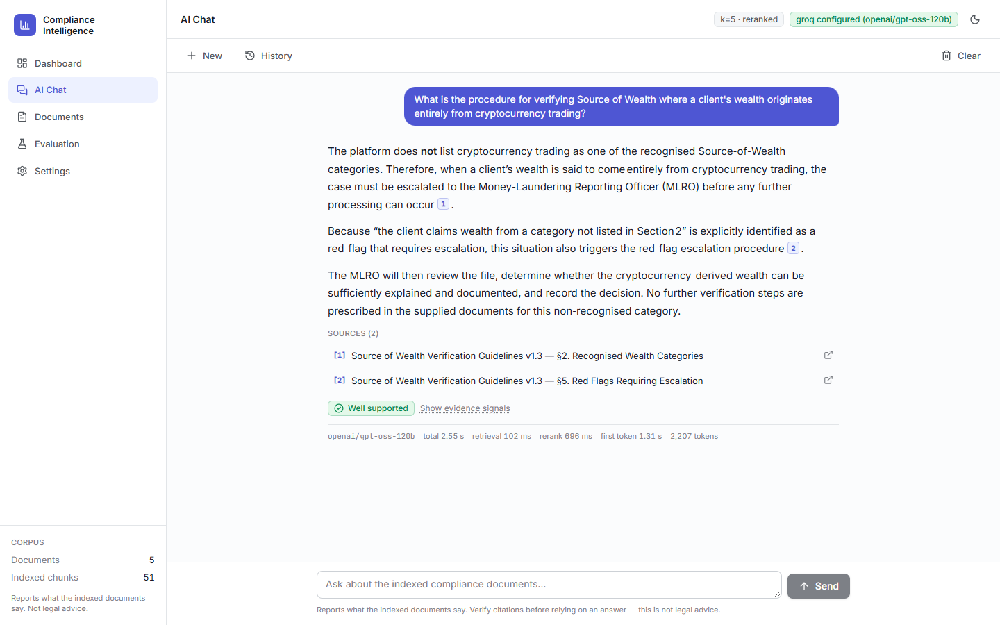</td>
</tr>
<tr>
<td><b>Document library: upload, version, status, re-index</b><br/>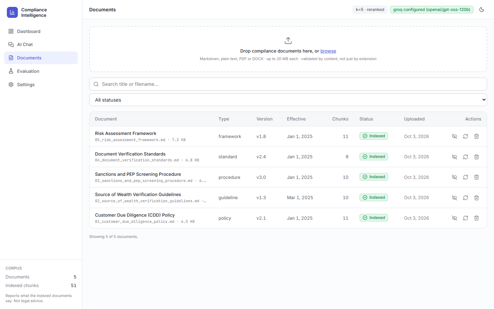</td>
<td><b>Document detail: how each policy was chunked</b><br/>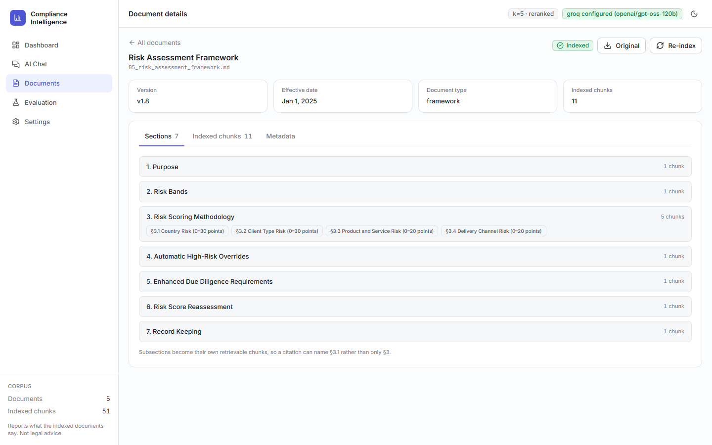</td>
</tr>
<tr>
<td><b>Evaluation dashboard</b><br/>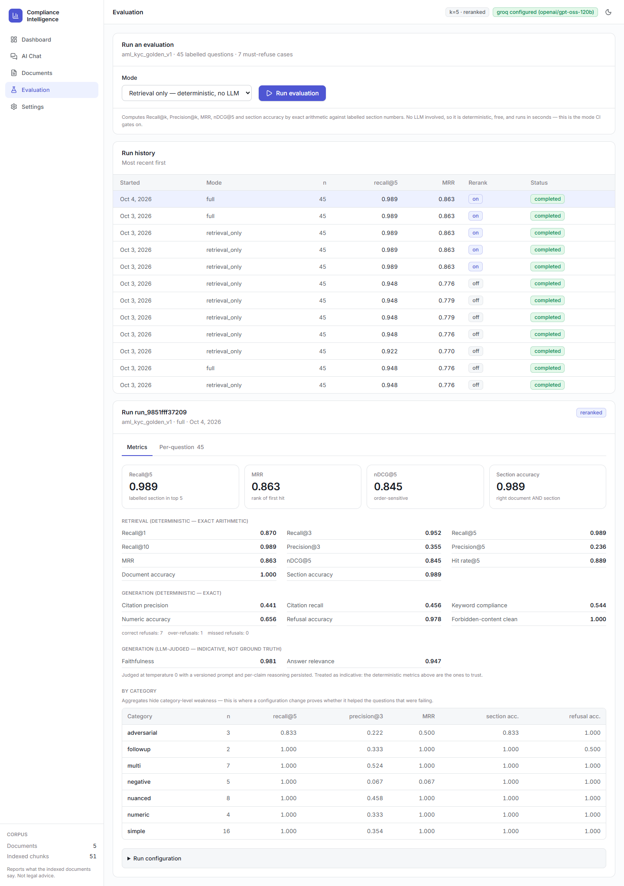</td>
<td><b>Dark mode</b><br/>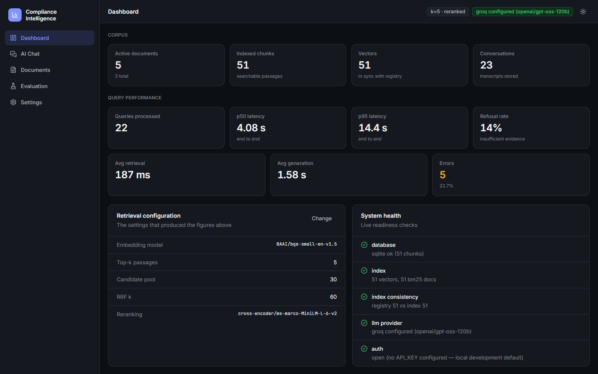<br/><br/><b>Interactive API docs</b><br/>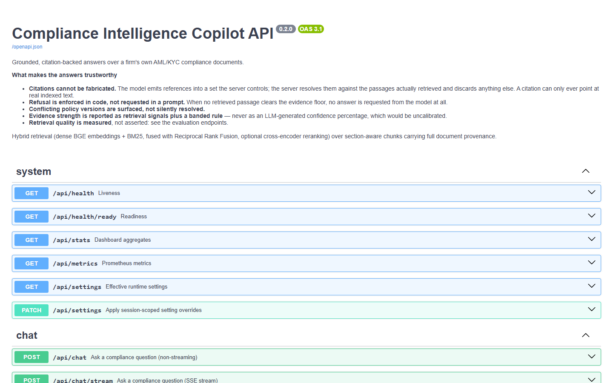</td>
</tr>
</table>

---

## Architecture

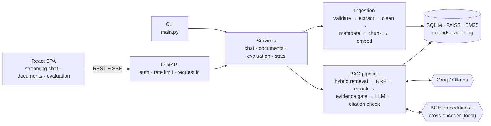

The web UI, the CLI and the evaluation harness all call **the same RAG pipeline**, so the evaluation measures exactly what users get.

### How a document is indexed

`upload` → validate file type by content (magic bytes) → extract text (MD / TXT / PDF / DOCX) → clean → extract version, effective date and owner → **split along the document's own numbered sections** (§3 → §3.1) → scan for prompt injection → embed into FAISS + add to BM25 → register in SQLite

### How a question is answered

1. Rewrite follow-up questions into standalone ones using conversation history
2. Search two ways at once: **semantic** (FAISS embeddings) and **keyword** (BM25)
3. Merge both result lists with **Reciprocal Rank Fusion**
4. **Rerank** the top 10 with a cross-encoder and keep the best 5
5. **Evidence gate:** if the best passage is too weak, refuse without calling the LLM
6. The LLM streams an answer with `[[cid:n]]` markers that point to passages
7. The server **checks every marker against the retrieved passages**, drops any unknown ones and renumbers them `[1]`, `[2]`
8. Check for conflicting policy versions, attach an evidence rating, and write the audit record

---

## Tech stack

| Area | Technology | Why |
|---|---|---|
| **Backend** | Python · FastAPI · Pydantic v2 · Uvicorn | Typed validation everywhere, native streaming (SSE), auto-generated OpenAPI docs |
| **Embeddings** | `BAAI/bge-small-en-v1.5` | Small, fast on CPU, free, runs offline |
| **Search** | FAISS + BM25 with Reciprocal Rank Fusion | Meaning *and* exact terms (PEP, EDD, §4.2), merged without score calibration |
| **Reranking** | `cross-encoder/ms-marco-MiniLM-L-6-v2` | +11% MRR on the evaluation set, so it ships enabled |
| **LLM** | Groq (`openai/gpt-oss-120b`) · Ollama | Fast free tier by default, with a fully offline option |
| **Storage** | SQLite (WAL) · local files · append-only JSONL audit log | Zero infrastructure, real transactions, append-only audit trail |
| **Frontend** | React 19 · TypeScript · Vite · Tailwind CSS 4 · TanStack Query | API types generated from OpenAPI, so a backend change surfaces as a compile error |
| **Quality** | pytest · Vitest · ruff · custom evaluation harness | 117 offline backend tests and exact retrieval metrics |
| **Delivery** | Docker · Docker Compose · nginx · GitHub Actions | One-command stack; CI runs lint, tests, the retrieval gate, a security audit and a Docker smoke test |

**Deliberately not used:** LangChain / LlamaIndex (the pipeline is explicit and testable stage by stage), RAGAS (metrics are written by hand and transparent), Postgres / Redis / a vector DB service (not needed at this scale; storage sits behind interfaces for a later swap).

---

## Results

Measured on a hand-labelled golden set of **45 questions** across 7 categories (simple, multi-document, nuanced, numeric, must-refuse, adversarial, follow-up).

| Retrieval metric | Hybrid search only | **+ reranking (shipped)** |
|---|---|---|
| Recall@1 | 0.774 | **0.870** |
| Recall@5 | 0.948 | **0.989** |
| MRR | 0.776 | **0.863** |
| nDCG@5 | 0.781 | **0.845** |
| Section accuracy | 0.948 | **0.989** |

- **0 missed refusals.** It never invented a procedure for an out-of-scope question.
- **Multi-document questions:** recall@5 went from 0.738 to **1.000** with reranking.
- **Structure-aware chunking** improved recall@5 by **21%** over the original version.
- **Speed:** retrieval takes ~70 ms and the first streamed token arrives in ~1.5–2 s. The original version took ~22 s per query.

Reproduce: `python -m eval.run --mode retrieval_only` (offline, ~25 s, no API key).

---

## How it was built

The project started as a take-home CLI (`ingest` + `query`, JSON output, 5/5 on the public questions) and was rebuilt into a full platform in phases:

| Phase | What was built |
|---|---|
| **0. Analysis** | Audited v1 and catalogued 18 defects. The biggest: chunks lost their subsection headings, so citations pointed at the wrong section |
| **1. Foundation** | Layered backend (API → services → RAG → ingestion → storage), structured logging, typed errors, lint, tests, CI |
| **2. Ingestion** | Multi-format extraction, metadata, structure-aware chunking, stable IDs, per-document delete and re-index |
| **3. Retrieval quality** | Hybrid search, reranking, evidence gate, citation verification, conflict detection, follow-up rewriting |
| **4. Evaluation** | 45-question golden set, exact metrics and LLM judges. Every later decision was made by measurement |
| **5. API** | 23 REST endpoints, SSE streaming, conversation memory, uniform errors, OpenAPI |
| **6. Frontend** | 6-page React app with streaming chat, clickable citations and an evaluation dashboard |
| **10. Docker** | Two-container Compose stack with model weights baked in, healthchecks and seed-on-boot |

<details>
<summary>Where it started: the v1 CLI</summary>


</details>

---

## Getting started

### Prerequisites
- Python 3.10+ (3.11 recommended) and Node ≥ 20.19
- A free [Groq API key](https://console.groq.com/keys), **or** [Ollama](https://ollama.com) for a fully offline run

### Run locally

```bash
# Backend
python -m venv .venv
source .venv/bin/activate          # Windows: .\.venv\Scripts\Activate.ps1
pip install -r requirements-dev.txt
cp .env.example .env               # add GROQ_API_KEY

python main.py ingest --docs ./policies   # 5 policies → 51 chunks
python main.py serve                      # API: http://127.0.0.1:8000/docs

# Frontend (new terminal)
cd frontend
npm install
npm run dev                               # UI: http://localhost:3000
```

### Run with Docker

```bash
cp .env.example .env               # add GROQ_API_KEY
docker compose -f docker-compose.yml up --build -d
# open http://localhost:3000
```

### Use the CLI

```bash
python main.py query --question "How frequently must sanctions screening be repeated for medium-risk clients?" --k 5
```

### Offline mode
```bash
ollama pull llama3.1:8b-instruct
# in .env: LLM_PROVIDER=ollama
```

The first run downloads the embedding and reranking models (~220 MB) from Hugging Face. After that it works offline.

---

## API

Interactive docs are served at `/docs`. Main endpoints:

| Method | Endpoint | Purpose |
|---|---|---|
| `POST` | `/api/chat/stream` | Ask a question and stream the answer (SSE) |
| `POST` | `/api/chat` | Ask a question and get a single JSON response |
| `GET` `POST` | `/api/documents` | List or upload documents |
| `GET` `PATCH` `DELETE` | `/api/documents/{id}` | Inspect, activate/deactivate, or delete a document |
| `POST` | `/api/documents/{id}/reindex` | Re-run ingestion |
| `GET` | `/api/conversations` | Chat history |
| `POST` `GET` | `/api/evaluation/runs` | Run or view evaluations |
| `GET` | `/api/stats` · `/api/health/ready` · `/api/metrics` | Dashboard data, readiness checks, Prometheus metrics |

---

## Project structure

```
├── main.py                 CLI: ingest · query · serve · rebuild-index
├── backend/app/
│   ├── api/                FastAPI routers, middleware, schemas
│   ├── services/           chat, documents, evaluation, stats
│   ├── rag/                retrieval, reranker, prompts, LLM, citations, guardrails, pipeline
│   ├── ingestion/          validators, extractors, cleaning, metadata, chunking, injection scan
│   ├── storage/            SQLite, FAISS, BM25, file store
│   ├── observability/      audit log, metrics
│   └── core/               config, errors, logging, security
├── eval/                   golden set, metrics, LLM judges, runner
├── tests/                  unit + integration tests (offline)
├── frontend/               React + TypeScript app
├── policies/               the 5-document AML/KYC corpus
├── docs/screenshots/       images used in this README
└── .github/workflows/      CI pipeline
```

---

## Testing and CI

```bash
pytest tests -q                              # 117 tests, ~12 s, no network or API key
python -m eval.run --mode retrieval_only     # retrieval metrics, offline
cd frontend && npm run verify                # typecheck + lint + tests + build
```

GitHub Actions runs four jobs on every push:
- **Lint + tests**
- **Retrieval regression gate:** fails if recall@5 drops below 0.95
- **Security audit:** `pip-audit` plus a check for committed secrets
- **Docker build:** builds both images, starts the stack, smoke-tests it, and runs the tests and evaluation inside the container

---

## Security

Implemented: file validation by content, size and page limits, content-addressed storage (no path traversal), API key auth with roles, rate limiting, prompt-injection defences, secrets kept out of responses and logs (question text is hashed in logs), and a uniform error format with no stack traces.

Production identity (SSO/OIDC), per-document access control and immutable audit storage are designed but **not implemented**.

---

<div align="center">
<sub>Built by Rashmi Pubuditha · Answers reflect the indexed documents and are not legal advice.</sub>
</div>
